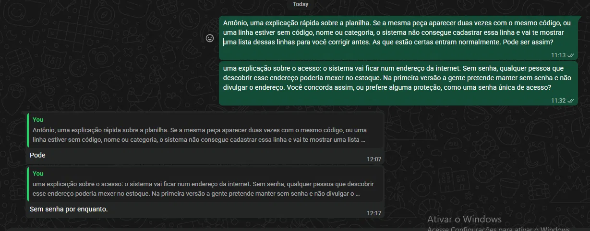

# Levantamento de dados da loja — complemento de 27/11 (acesso e importação)

- **Data:** 27/11/2026
- **Tipo:** Levantamento assíncrono via WhatsApp, sem reunião formal, conforme o processo de registro de evidências descrito em [Comunicação](../visao-produto/interacao-equipe-cliente.md#comunicacao)
- **Participantes:** Antônio Marcos (cliente); João Melo (equipe)

## Contexto

Este registro complementa o [levantamento de 26/11/2026](levantamento-dados-loja.md). Depois daquela conversa, a equipe enviou ao cliente duas perguntas adicionais, uma sobre o risco do acesso sem senha e outra sobre o tratamento de linhas inválidas na importação da planilha. À noite, a equipe enviou uma correção da descrição da importação. Não houve reunião nem demonstração do sistema, e a conversa não valida critérios de aceitação de nenhuma história.

## Respostas do cliente

| Assunto | Pergunta enviada pela equipe | Resposta | Horário |
|---|---|---|---|
| Acesso ao sistema | "uma explicação sobre o acesso: o sistema vai ficar num endereço da internet. Sem senha, qualquer pessoa que descobrir esse endereço poderia mexer no estoque. Na primeira versão a gente pretende manter sem senha e não divulgar o endereço. Você concorda assim, ou prefere alguma proteção, como uma senha única de acesso?" | "Sem senha por enquanto." | Pergunta às 11h32; resposta às 12h17 |
| Importação da planilha | "Antônio, uma explicação rápida sobre a planilha. Se a mesma peça aparecer duas vezes com o mesmo código, ou uma linha estiver sem código, nome ou categoria, o sistema não consegue cadastrar essa linha e vai te mostrar uma lista dessas linhas para você corrigir antes. As que estão certas entram normalmente. Pode ser assim?" | "Pode" | Pergunta às 11h13; resposta às 12h07 |
| Importação da planilha (correção) | "Antônio, só um ajuste no que te expliquei da planilha: se alguma linha tiver problema (sem código, código repetido ou sem categoria), o sistema não importa o arquivo e mostra a lista do que corrigir. Pra primeira carga, a gente mesmo prepara a planilha pra você, tirando as repetidas e te mandando só as linhas sem código pra você conferir. Pode ser assim?" | "Pode sim" | Pergunta às 20h35; resposta às 20h35 |

## Leitura das respostas

- **Acesso:** o cliente foi informado de que o sistema ficará num endereço da internet e de que, sem senha, quem descobrisse o endereço poderia alterar o estoque. Foi oferecida a alternativa de uma senha única de acesso, e ele respondeu "Sem senha por enquanto." A resposta confirma o acesso sem senha na primeira versão e indica que a decisão pode ser revista. A pergunta apresentou a intenção da equipe antes da alternativa.
- **Importação:** a primeira pergunta (11h13) descreveu um comportamento em que o sistema lista as linhas com problema e cadastra as demais ("As que estão certas entram normalmente"). Esse comportamento difere do critério de importação da [US02](../visao-produto/requisitos-de-software.md#us02), que rejeita o lote inteiro quando há linha inválida, e o "Pode" (12h07) concordou com a descrição enviada, não com o critério atual. Às 20h35, a equipe corrigiu a descrição: se alguma linha tiver problema, o sistema não importa o arquivo e mostra a lista do que corrigir; na primeira carga, a equipe prepara a planilha, tirando as repetidas, e envia ao cliente só as linhas sem código para conferência. O cliente respondeu "Pode sim". A resposta concorda com o comportamento atual da US02 e com o preparo do arquivo pela equipe na primeira carga, sem validar a US02.

## Pendências em 27/11/2026

Os desdobramentos são acompanhados nas issues e em registros posteriores, sem alterar esta ata.

- **Primeira carga:** o envio ao cliente das linhas sem código, para conferência, e o preenchimento da categoria das peças seguem pendentes.
- **Acesso:** a decisão vale "por enquanto", sem prazo ou condição definidos pelo cliente.
- Os demais pontos em aberto do levantamento de 26/11 (códigos equivalentes, categoria, origem do saldo inicial e exportação do Mercado Livre) permanecem como estão naquele registro.

## Evidência

*Figura 1: Perguntas da equipe, às 11h13 e 11h32, e respostas do cliente, às 12h07 e 12h17.*

*Figura 2: Correção da descrição da importação, às 20h35, e resposta do cliente, às 20h35.*
