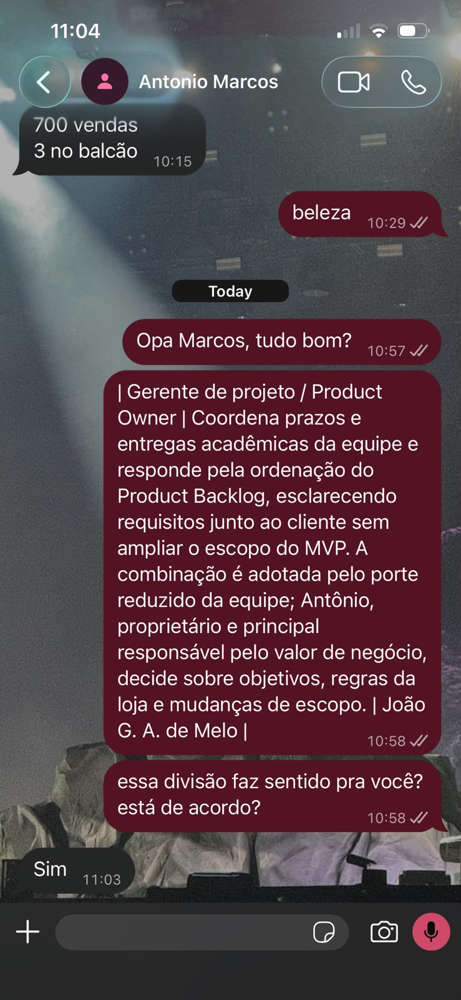

# Validação assíncrona — Papel de Gerente de projeto / Product Owner

- **Data:** 12/10/2026
- **Tipo:** Validação assíncrona via WhatsApp, sem reunião formal — conforme o processo de registro de evidências descrito no item 7.2 de [Interação entre equipe e cliente](../visao-produto/interacao-equipe-cliente.md)
- **Participantes:** Antônio Marcos (cliente); Luiz Henrique Tomaz Moreira (equipe)

## Decisão

A equipe enviou a Antônio Marcos, pelo WhatsApp, a descrição do papel "Gerente de projeto / Product Owner" registrada no item 7.1 de [Interação entre equipe e cliente](../visao-produto/interacao-equipe-cliente.md), incluindo a justificativa da acumulação dos dois papéis pelo porte reduzido da equipe. Antônio confirmou estar de acordo com a divisão de responsabilidades descrita.

## Evidência

*Figura — Print da conversa no WhatsApp confirmando a validação do papel pelo cliente.*
