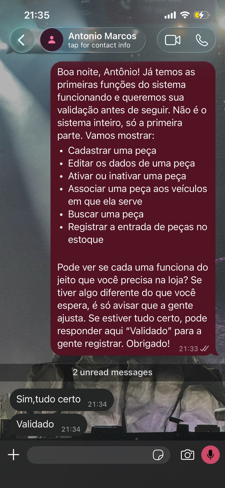

# Validação assíncrona — Funções iniciais do sistema

- **Data:** 16/11/2026
- **Tipo:** Validação assíncrona via WhatsApp, sem reunião formal, conforme o processo de registro de evidências descrito em [Comunicação](../visao-produto/interacao-equipe-cliente.md#comunicacao)
- **Participantes:** Antônio Marcos (cliente); João Melo (equipe)

## Decisão

A equipe enviou a Antônio Marcos, pelo WhatsApp, às 21h33, a lista das primeiras funções do sistema já desenvolvidas e perguntou se cada uma funciona do jeito que ele precisa na loja. As funções enviadas correspondem às histórias [US01](../visao-produto/requisitos-de-software.md#us01) (cadastrar peça), [US05](../visao-produto/requisitos-de-software.md#us05) (editar peça), [US06](../visao-produto/requisitos-de-software.md#us06) (alterar status da peça, ativar e inativar), [US03](../visao-produto/requisitos-de-software.md#us03) (associar veículo à peça), [US04](../visao-produto/requisitos-de-software.md#us04) (buscar peça) e [US08](../visao-produto/requisitos-de-software.md#us08) (registrar entrada de peças).

Às 21h34, o cliente respondeu "Sim, tudo certo" e "Validado". A resposta cobre as seis funções da mensagem, que representam apenas a primeira parte do sistema, e não o sistema completo.

## Evidência

*Figura: Print da conversa no WhatsApp com a validação das funções iniciais pelo cliente.*
