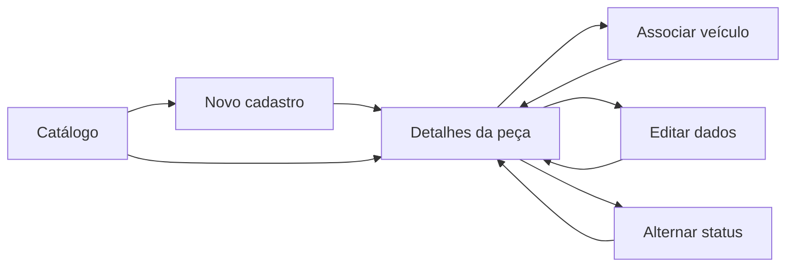

# Grupo 1 — Cadastro e manutenção de peças

[Abrir o grupo no protótipo](interface/index.html?grupo=catalog){ .md-button }

## Vínculos e objetivo

Representar a organização dos dados e das aplicações de uma peça, sua correção e sua
ativação/inativação: [US01 / #27](https://github.com/mdsreq-fga-unb/REQ-202562-T02-TSI-AutoPecas/issues/27),
[US03 / #29](https://github.com/mdsreq-fga-unb/REQ-202562-T02-TSI-AutoPecas/issues/29),
[US05 / #31](https://github.com/mdsreq-fga-unb/REQ-202562-T02-TSI-AutoPecas/issues/31) e
[US06 / #32](https://github.com/mdsreq-fga-unb/REQ-202562-T02-TSI-AutoPecas/issues/32).
Origem: [EP01 / CP1](../visao-produto/requisitos-de-software.md#ep01).

## Telas e caminhos

O cadastro mostra código do fabricante, nome e categoria obrigatórios; localização,
descrição e foto são opcionais. O detalhe reúne identificação, aplicações, status e
saldo compartilhado com o grupo 3. Na edição, o código permanece somente para leitura.

## Roteiro de avaliação

| Cenário | Tarefa para o proprietário | O que observar | Referência |
| --- | --- | --- | --- |
| Cadastro mínimo | Cadastre “Filtro de ar”, código “FAR-700”, categoria “Filtros”, sem foto. | Compreensão dos campos obrigatórios e da confirmação. | CA01.1 e CA01.3 |
| Campos ausentes | Tente salvar um cadastro sem nome e depois complete-o. | Identificação do campo ausente e recuperação sem perder os demais dados. | CA01.2 |
| Dados opcionais | Inclua localização, descrição e uma imagem fictícia. | Encontrar esses dados nos detalhes após salvar. | CA01.3 |
| Aplicações | Associe Fiat / Uno / 2012 e depois Fiat / Palio / 2013 à mesma peça de exemplo. | Preservação das duas associações e entendimento do ano. | CA03.1 e CA03.2 |
| Aplicação incompleta | Tente associar um veículo sem marca, modelo ou ano. | Orientação para completar o dado ausente. | CA03.3 |
| Correção | Corrija nome e localização; observe o código. Depois tente deixar a categoria vazia. | Edição do mesmo cadastro, código imutável e obrigatoriedade preservada. | CA05.1–CA05.3 |
| Status | Inative e reative a peça. | Compreensão do status e preservação dos dados e do saldo. | CA06.1–CA06.3 |

## Perguntas para refinamento

- Ao informar um código já existente manualmente, deve ser sugerida a peça existente,
  rejeitado o cadastro ou adotado outro tratamento? O protótipo apenas aponta a pendência.
- O ano será individual ou um intervalo? Como tratar aplicações repetidas?
- A edição deve permitir corrigir e remover aplicações? Esses caminhos aguardam definição.
- O que muda ao inativar uma peça nas buscas, movimentações e vendas? A demonstração
  mantém a peça visível e não define bloqueios; isso não constitui aprovação dessa regra.
- Qual será o saldo inicial de uma peça nova? Zero é somente a convenção visual utilizada.

**Evidência a produzir:** observações e decisões por cenário, vinculadas às issues,
conforme o [registro sugerido](index.md#registro-sugerido-para-a-issue-ou-ata).

## Versionamento

| Versão | Data | Descrição | Autor(es/as) |
| :----: | :--: | --- | --- |
| 1.0 | 10/11/2026 | Criação do roteiro de prototipação de cadastro e manutenção de peças, contemplando US01, US03, US05 e US06. | [Bruno Ferreira](https://github.com/brunnf) |
