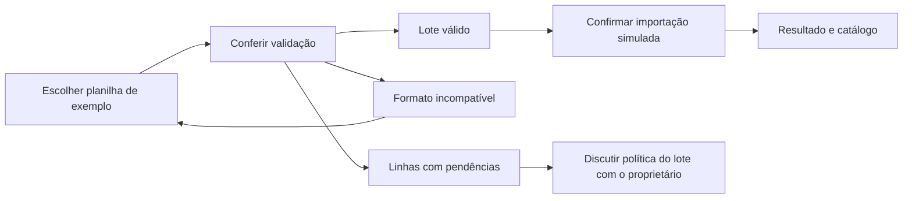

# Grupo 2 — Importação de peças por planilha

[Abrir o grupo no protótipo](interface/index.html?grupo=import){ .md-button }

## Vínculo e objetivo

Representar a seleção, conferência e conclusão do cadastro em lote da
[US02 / #28](https://github.com/mdsreq-fga-unb/REQ-202562-T02-TSI-AutoPecas/issues/28),
vinculada ao [EP01 / CP1](../visao-produto/requisitos-de-software.md#ep01).
Os dados usam o cadastro definido na US01. A interação usa exemplos prontos e não
lê planilhas reais; não representa carga de saldos nem histórico de operações.

## Telas e caminhos

## Roteiro de avaliação

Reinicie a demonstração antes do lote válido para recuperar os dados iniciais.

| Cenário | Tarefa para o proprietário | O que observar | Referência |
| --- | --- | --- | --- |
| Lote válido | Escolha `pecas-validas.xlsx`, confira os registros e conclua a simulação. | Clareza da revisão, confirmação e acesso às duas peças importadas. | CA02.1 |
| Código existente | Escolha `pecas-com-pendencias.xlsx` e encontre a linha com FLT-100. | Entendimento de que o registro existente não será sobrescrito. | CA02.2 |
| Linha incompleta | No mesmo exemplo, identifique a linha sem nome. | Localização da linha rejeitada e compreensão do problema. | CA02.3 |
| Formato incompatível | Escolha `pecas.csv`. | Mensagem sobre a necessidade de `.xlsx` e retorno para seleção. | Formato previsto em RF02 |
| Repetir lote | Após importar o lote válido, tente usá-lo novamente. | Preservação dos códigos já existentes. | CA02.2 |

## Perguntas para refinamento

- Quais colunas, nomes e formatos compõem a planilha?
- Como tratar códigos repetidos dentro do próprio arquivo?
- Um lote com erro é rejeitado por inteiro ou importa somente as linhas válidas?
  O cenário com pendências não efetiva a importação, para não decidir essa política.
- Quais informações ajudam a corrigir uma linha e tentar novamente?
- Como alinhar o CA02.4, de autorização por perfil, com o recorte sem gestão de usuários?
  Esse critério não é simulado.

**Evidência a produzir:** avaliação das mensagens, proposta de colunas e decisão sobre
o lote com erros, registrada na issue. [Orientações de registro](index.md#registro-sugerido-para-a-issue-ou-ata).
