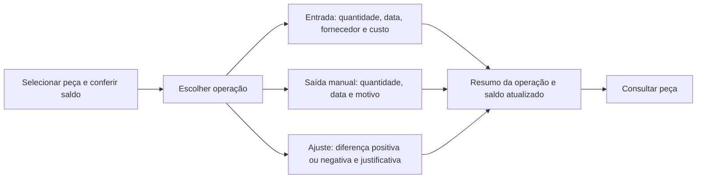

# Grupo 4 — Movimentação de estoque

[Abrir o grupo no protótipo](interface/index.html?grupo=stock){ .md-button }

## Vínculos e objetivo

Representar três tarefas distintas que compartilham seleção da peça e apresentação
do saldo: [US08 / #33](https://github.com/mdsreq-fga-unb/REQ-202562-T02-TSI-AutoPecas/issues/33),
[US09 / #34](https://github.com/mdsreq-fga-unb/REQ-202562-T02-TSI-AutoPecas/issues/34) e
[US10 / #35](https://github.com/mdsreq-fga-unb/REQ-202562-T02-TSI-AutoPecas/issues/35),
do [EP02 / CP2](../visao-produto/requisitos-de-software.md#ep02).
A consulta resultante reutiliza US12. Não há listagem geral nem filtro de histórico.

## Telas e caminhos

## Roteiro de avaliação

| Cenário | Tarefa para o proprietário | O que observar | Referência |
| --- | --- | --- | --- |
| Entrada | Com PST-200 em 5 unidades, registre entrada de 3, data, fornecedor de exemplo e custo. | Dados da operação, saldo 8 e preservação das outras peças. | CA08.1–CA08.3 |
| Saída manual | Após a entrada, registre saída de 3 PST-200 por avaria. | Saldo 5 e identificação do motivo, sem criar uma venda. | CA09.1–CA09.3 |
| Ajuste positivo | Reinicie; ajuste FLT-100 em +2 por diferença de contagem. | Saldo 10 → 12 e entendimento de “diferença”. | CA10.1 |
| Ajuste negativo | Reinicie; ajuste FLT-100 em −3 com justificativa. | Saldo 10 → 7, em vez de interpretar −3 como saldo final. | CA10.2 |
| Justificativa ausente | Tente concluir um ajuste sem justificativa. | Identificação do campo e preservação do saldo. | CA10.4 |
| Situação em aberto | Tente retirar mais unidades que o saldo ou ajustar a diferença para zero. | Discutir o comportamento desejado; a simulação não decide a regra. | Refinamento das US09 e US10 |

## Perguntas para refinamento

- A US08 depende de um fornecedor identificado em US07, fora deste recorte. Como
  resolver essa dependência na entrega? O protótipo usa somente uma opção fictícia.
- Quais campos e limites de quantidade, data e custo serão obrigatórios na entrada?
- São permitidos saldos negativos? O aviso do protótipo interrompe esse cenário por
  falta de decisão, sem estabelecer uma proibição de negócio.
- Como tratar um ajuste igual a zero?
- A distinção entre saída manual, venda e ajuste é compreensível para o proprietário?
- Como alinhar o CA10.3, de autorização por perfil, ao MVP sem gestão de usuários?

O resumo mostra apenas a operação recém-simulada, para avaliar sua confirmação.
Não representa a implementação de um histórico de movimentações.

**Evidência a produzir:** interpretação das operações, conferência dos saldos e
decisões pendentes, conforme o [registro sugerido](index.md#registro-sugerido-para-a-issue-ou-ata).

## Versionamento

| Versão | Data | Descrição | Autor(es/as) |
| :----: | :--: | --- | --- |
| 1.0 | 10/11/2026 | Criação do roteiro de prototipação de movimentação de estoque, contemplando US08, US09 e US10. | [Bruno Ferreira](https://github.com/brunnf) |
