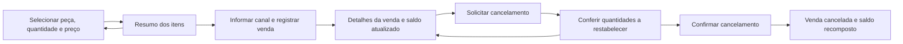

# Grupo 5 — Registro e cancelamento de vendas

[Abrir o grupo no protótipo](interface/index.html?grupo=sales){ .md-button }

## Vínculos e objetivo

Representar uma venda com um ou vários itens e sua reversão:
[US15 / #38](https://github.com/mdsreq-fga-unb/REQ-202562-T02-TSI-AutoPecas/issues/38) e
[US16 / #39](https://github.com/mdsreq-fga-unb/REQ-202562-T02-TSI-AutoPecas/issues/39),
do [EP03 / CP3](../visao-produto/requisitos-de-software.md#ep03).
A identificação das peças e a consulta do saldo reaproveitam os grupos anteriores.

## Telas e caminhos

## Roteiro de avaliação

| Cenário | Tarefa para o proprietário | O que observar | Referência |
| --- | --- | --- | --- |
| Composição | Selecione peças, quantidades, preços e canal; remova um item antes de concluir. | Clareza do resumo e distinção entre preparar e registrar a venda. | CA15.1; remoção é proposta de interação |
| Um item | Reinicie; venda 3 unidades de FLT-100. | Saldo 10 → 7 somente ao registrar. | CA15.2 |
| Vários itens | Reinicie; venda 3 FLT-100 e 2 PST-200. | Saldos 10 → 7 e 5 → 3; COR-300 permanece em zero. | CA15.3 |
| Desistir do cancelamento | Abra a venda, solicite cancelamento e escolha “Manter venda”. | Nenhuma mudança nos saldos antes da confirmação. | Proposta de interação |
| Cancelar | Confirme o cancelamento da venda de vários itens. | Retorno a 10 e 5, sem alteração das outras peças. | CA16.1 |
| Preservar outra operação | Reinicie; venda 3 FLT-100, registre saída manual de 3 no grupo 4 e cancele a venda. | Saldo 10 → 7 → 4 → 7, preservando a saída manual. | CA16.2 |
| Cancelamento repetido | Reabra a venda já cancelada. | Situação cancelada, sem nova ação que devolva quantidades novamente. | CA16.4 |
| Saldo insuficiente | Prepare uma venda com quantidade maior que a disponível e tente registrá-la. | Avaliar a mensagem e discutir a regra; a simulação para sem decidir a política. | Refinamento da US15 |

## Perguntas para refinamento

- Quais canais de origem devem existir? Balcão, Mercado Livre e contato direto são
  exemplos retirados do contexto do negócio, não uma lista de valores já aprovada.
- O preço representa valor unitário ou total? O protótipo propõe preço unitário para
  permitir a avaliação do resumo e do total.
- Como tratar quantidade superior ao saldo e peças inativas?
- A confirmação apresenta informação suficiente para evitar cancelar a venda errada?
- Como alinhar o CA16.3, de autorização por perfil, ao recorte sem gestão de usuários?
  Autorização não é simulada.

Não são representados recebimentos, emissão fiscal, devoluções ou integração com
marketplaces. “Mercado Livre” identifica apenas o canal informado na venda.

**Evidência a produzir:** avaliação do resumo, da confirmação e dos saldos por peça,
seguindo o [registro sugerido](index.md#registro-sugerido-para-a-issue-ou-ata).
