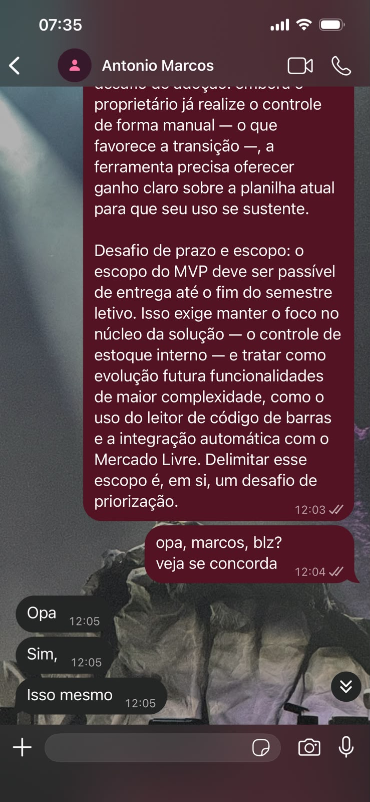
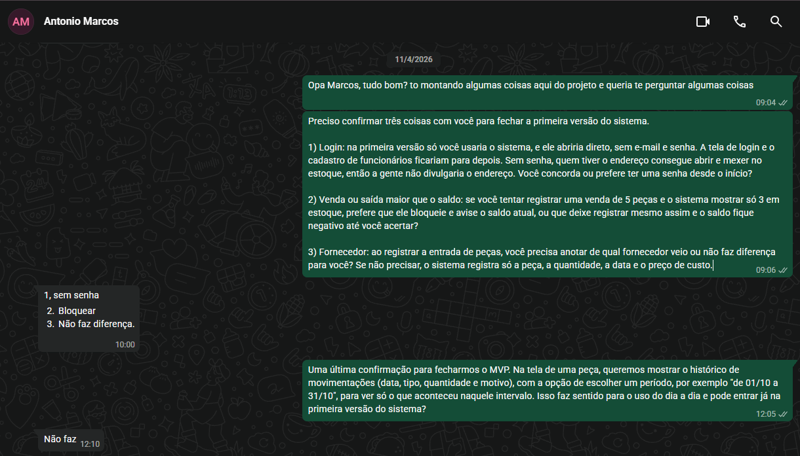
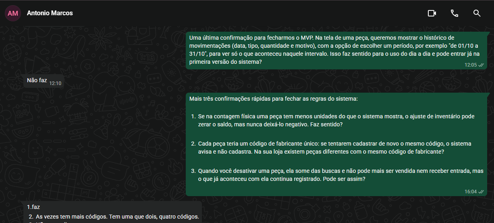

# Cliente e negócio {#cliente-e-negocio}

## Identificação do cliente/parceiro {#identificacao-do-clienteparceiro}

| Informação | Descrição |
| --- | --- |
| Nome | TSI Peças |
| Tipo | Cliente real: microempresa do ramo de autopeças, dedicada ao comércio varejista de peças automotivas. |
| Representante | Antônio Marcos, proprietário e único operador da loja. |
| Forma de contato | Encontros presenciais com o proprietário e comunicação por WhatsApp. |
| Vínculo com o projeto | Principal stakeholder e usuário administrador. Procurou a equipe relatando a necessidade da ferramenta; participa da validação dos requisitos e da homologação das entregas. |

## Introdução ao negócio e contexto {#introducao-ao-negocio-e-contexto}

A TSI Peças é uma microempresa do ramo de autopeças que atua no comércio varejista de peças automotivas. O negócio é conduzido integralmente por Antônio Marcos, proprietário e único operador, responsável por todas as etapas da operação: compra, cadastro, venda e controle de estoque.

A empresa comercializa exclusivamente peças de automóveis, sem prestação de serviços, e opera por três canais de venda:

- **Balcão da loja física:** atendimento e venda presencial.
- **Mercado Livre:** comercialização por meio do marketplace.
- **Contato direto com o cliente:** pedidos por telefone ou mensagem, com envio pelos Correios.

O controle da operação é feito manualmente, com apoio de planilhas parciais do Excel, sem automação entre o registro de vendas e a atualização do estoque.

## Validação do cliente

O conteúdo da Visão de Produto e Projeto foi validado pelo cliente, Antônio Marcos, em dois momentos: na revisão dos desafios do projeto e na análise do documento completo, que foi aprovado pelo proprietário.

*Figura — Validação dos desafios do projeto pelo cliente.*

*Figura — Aprovação do documento completo pelo cliente.*

Em 04/11/2026, a equipe validou com o cliente, pelo WhatsApp, as regras que fecharam o recorte do MVP: acesso sem login, bloqueio de saída e venda acima do saldo, entrada sem fornecedor, histórico por período, ajuste de inventário sem saldo negativo e peças com mais de um código. As decisões resultantes estão registradas no [Backlog](requisitos-de-software.md) e na [priorização](priorizacao.md#decisoes-gerais-da-priorizacao).

*Figura — Validação, em 04/11/2026, sobre login, venda acima do saldo e fornecedor.*

*Figura — Validação sobre histórico por período, ajuste de inventário e códigos de peças.*

## Acesso ao MVP {#acesso-ao-mvp}

Em 04/11/2026, o cliente validou, pelo WhatsApp, o acesso ao sistema sem login. Em 26/11/2026, informou que usará o sistema no computador da loja, que no momento é o único usuário e que a primeira versão sem senha atende ([Levantamento de dados da loja](../atas/levantamento-dados-loja.md)). A confirmação final veio em resposta a uma pergunta sugerida pela equipe.

**Onde será disponibilizado.** O plano prevê front-end na Vercel, back-end na Render e banco no Supabase ([Solução e características](solucao-e-caracteristicas.md)). O deploy em produção ainda não foi realizado.

**Quem acessa.** A aplicação é usada por Antônio Marcos, como único operador; a equipe a acessa para manutenção e integrações futuras. O acesso às contas da infraestrutura passa ao cliente na Sprint 6 ([Intervenção social](intervencao-social.md#d09)).

**Decisão.** Na primeira versão, o sistema abre sem autenticação e o endereço não é divulgado. A proteção por HTTPS ([RNF05](requisitos-de-software.md#rnf05-seguranca-de-dados)) protege o tráfego, mas não define quem pode acessar.

**Risco.** Enquanto não houver autenticação, quem conhecer o endereço do front-end ou da API pode cadastrar, alterar, movimentar e registrar vendas. Em 27/11/2026, a equipe explicou isso ao cliente e perguntou se ele concordava ou preferia uma senha única de acesso; ele respondeu "Sem senha por enquanto." ([Levantamento de dados da loja, complemento de 27/11](../atas/levantamento-dados-loja-27-11.md)).

**Evolução futura.** Autenticação e gestão de usuários ficam fora do MVP e dependem de nova decisão ([CP9](solucao-e-caracteristicas.md#cp9)). Antes do deploy em produção, a equipe verifica se uma restrição simples de acesso, como uma senha única do ambiente, é viável sem custo adicional e registra o resultado.

## Versionamento

| Versão | Data | Descrição | Autor(es/as) |
| :----: | :--: | --- | --- |
| 1.0 | 04/09/2026 | Iniciação do documento | [Thiago Gomes](https://github.com/thgomxs) |
| 1.1 | 07/09/2026 | Preenchimento dos itens 1.1 e 1.2 e revisão textual | [João Melo](https://github.com/jot4-ge) |
| 1.2 | 09/09/2026 | Inclusão das evidências de validação do cliente | [João Melo](https://github.com/jot4-ge) |
| 1.3 | 04/11/2026 | Remoção da numeração estrutural e ajuste da hierarquia dos títulos, com links estáveis e preservação das âncoras anteriores. | [Thiago Gomes](https://github.com/thgomxs) |
| 1.4 | 15/11/2026 | Inclusão das evidências da validação das decisões de escopo do MVP com o cliente (04/11/2026), no contexto da issue #53. | [João Melo](https://github.com/jot4-ge) |
| 1.5 | 27/11/2026 | Registro da decisão de acesso ao MVP sem autenticação, do uso previsto, do risco, da resposta do cliente e da evolução futura, no contexto da issue #83. | [João Melo](https://github.com/jot4-ge) |
