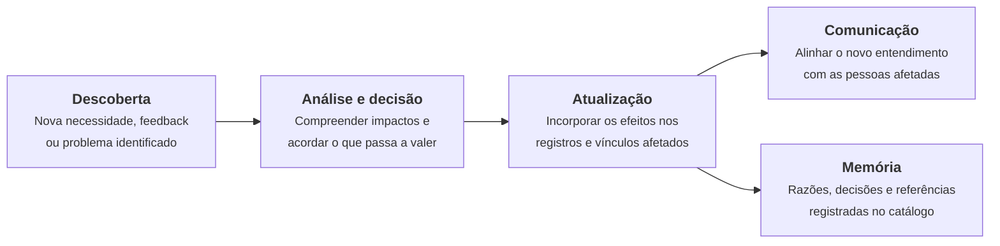

# Histórico de evolução dos requisitos

## 12 Histórico de evolução dos requisitos

O escopo do produto muda ao longo do projeto. Esta página registra **como a equipe incorpora uma
mudança** e **quais decisões já alteraram o escopo**, de modo que seja possível recuperar o que
mudou, por quê e quais elementos foram afetados.

A memória de cada requisito individual fica no campo *Evolução* do seu registro no
[Catálogo de requisitos](requisitos-de-software.md). Esta página reúne a visão por entrega.

### 12.1 Rotina de atualização

Sempre que o entendimento do escopo muda, a equipe percorre os mesmos quatro passos, com esforço
proporcional ao impacto da mudança.

| Passo | O que a equipe faz | Onde fica o resultado |
| --- | --- | --- |
| Descoberta | Registra o achado: feedback do cliente ou da monitoria, impedimento técnico, incoerência encontrada na revisão. | Issue no repositório ou [ata](../atas/index.md) da reunião |
| Análise e decisão | Identifica os registros, vínculos e critérios potencialmente afetados e acorda o que passa a valer. | Discussão registrada na issue ou na ata |
| Atualização | Altera o registro no catálogo — declaração, origem, condições, priorização, entrega ou situação — e confere os vínculos afetados. | [Catálogo de requisitos](requisitos-de-software.md) |
| Comunicação | Informa quem depende da informação alterada: equipe, monitoria e, quando aplicável, o proprietário. | Sprint Review, ata ou comentário na issue |
| Memória | Anota data e motivo no campo *Evolução* do registro e acrescenta a linha desta página. | Registro do requisito e seção 12.3 |

### 12.2 Propagação de uma mudança

Uma alteração raramente atinge um elemento só. Antes de encerrar a atualização, a equipe confere os
quatro eixos abaixo — a mesma verificação, independentemente do tamanho da mudança.

| Eixo | O que conferir |
| --- | --- |
| Declaração e regras | O texto vigente do requisito ainda descreve o comportamento acordado? Alguma regra associada mudou junto? |
| Critérios de confirmação | Os critérios continuam verificáveis e coerentes com a nova declaração? |
| Vínculos | Origem, RNFs aplicáveis e dependências continuam corretos? Algum requisito que depende deste foi afetado? |
| Entrega e visões | O recorte de entrega e a sprint continuam viáveis? O índice do catálogo, o [quadro do MVP](mvp.md#104-quadro-de-acompanhamento-da-entrega) e o [cronograma](cronograma-e-entregas.md) refletem a mudança? |

**Exemplo de propagação.** Se o proprietário confirmar que o
[RF13](requisitos-de-software.md#rf13) precisa entrar no MVP — pendência registrada em
[Pontos em aberto do recorte](mvp.md#106-pontos-em-aberto-do-recorte) —, a mudança atinge: o
recorte de entrega e a situação do RF13; a dependência declarada no
[RF14](requisitos-de-software.md#rf14); a composição do épico
[EP02](mvp.md#ep02); a distribuição das histórias nas sprints; e a contagem de requisitos do MVP
registrada em [Priorização](priorizacao.md#96-decisoes-gerais-da-priorizacao).

### 12.3 Decisões que alteraram o escopo

Registro das decisões que mudaram requisitos, características ou o recorte de entrega. Cada linha
indica a data, a decisão, os elementos afetados e a origem da mudança.

| Data | Decisão | Elementos afetados | Origem |
| :--: | --- | --- | --- |
| 09/09/2026 | Revisão dos nomes e das descrições das características de produto. | CP1 a CP9 | Revisão interna da equipe |
| 22/09/2026 | Correção da afirmação sobre custos e inclusão das fontes na pesquisa de mercado. | Solução e características (2.5) | Issue #4 |
| 24/09/2026 | Reescrita dos objetivos específicos e das características no padrão de capacidade, com rastreabilidade explícita. | OE1 a OE5, CP1 a CP9 | Feedback da monitoria |
| 27/09/2026 | Inclusão do OE6 — centralização dos dados, com o sistema como fonte única. | OE6, CP1, CP5 | Feedback da monitoria (issue #4) |
| 30/09/2026 | Atualização geral dos RFs e RNFs para a versão vigente dos requisitos. | RF01 a RF40, RNF01 a RNF05 | Revisão interna da equipe |
| 02/10/2026 | Remoção da característica de vinculação do estoque aos anúncios: a integração com o Mercado Livre saiu do escopo do MVP. Características renumeradas. | CP1 a CP9, RF25 a RF40 | Validação com a monitoria |
| 02/10/2026 | Separação das operações de despesa em registrar, editar e excluir. | [RF28](requisitos-de-software.md#rf28), [RF29](requisitos-de-software.md#rf29), [RF30](requisitos-de-software.md#rf30) | Feedback da monitoria |
| 02/10/2026 | Esclarecimento do demonstrativo financeiro e correção da sobreposição entre os dados fiscais da peça e os da operação fiscal. | [RF31](requisitos-de-software.md#rf31), [RF32](requisitos-de-software.md#rf32), [RF33](requisitos-de-software.md#rf33) | Feedback da monitoria |
| 03/10/2026 | Devolução de peça passou a ser vinculada a uma venda; atualização de estoque no registro de venda simplificada. | [RF11](requisitos-de-software.md#rf11), [RF15](requisitos-de-software.md#rf15) | Feedback da monitoria |
| 05/10/2026 | Definição do método de priorização — VN, ET, MoSCoW e Score — e seleção de 13 requisitos para o MVP, 5 condicionados e 22 como evolução futura. | Todos os RFs; [Priorização](priorizacao.md) | Decisão da equipe |
| 10/10/2026 | Fragmentação da característica de integridade em duas: segurança/integridade dos dados e acessibilidade/responsividade. | CP7, CP8, RNF01 a RNF05 | Feedback da monitoria |
| 12/10/2026 | Definição dos três épicos e das 13 histórias de usuário do MVP, com os vínculos de CP, RF e RNF. | [EP01](mvp.md#ep01), [EP02](mvp.md#ep02), [EP03](mvp.md#ep03) e as 13 US | Decisão da equipe |
| 13/10/2026 | Realinhamento das características de origem dos RF25 a RF40, com a unificação de compras e análise na CP4. | [RF25](requisitos-de-software.md#rf25) a [RF40](requisitos-de-software.md#rf40) | Revisão de rastreabilidade |
| 03/11/2026 | **Consolidação do escopo em um catálogo integrado.** Cada requisito passou a ter um registro único, reunindo declaração, intenção e valor, origem, condições, priorização, entrega, situação e evolução. As listas paralelas de requisitos mantidas no Backlog de produto foram eliminadas, e as páginas de priorização, MVP e rastreabilidade passaram a consultar o catálogo. | Todos os registros; páginas 8 a 12 | Estudo de caso do Capítulo 12 |
| 03/11/2026 | Adoção dos nomes das características definidos na Visão do Produto como versão vigente, corrigindo a divergência com os nomes usados na página de requisitos (CP1 e CP2). | [CP1](solucao-e-caracteristicas.md#cp1), [CP2](solucao-e-caracteristicas.md#cp2) e seus requisitos | Revisão de consistência |
| 03/11/2026 | Registro das dependências entre requisitos, derivadas da leitura das declarações, com marcação explícita de que aguardam validação no refinamento. | Campo *Condições e avaliação* de 35 registros | Revisão de consistência |

### 12.4 Pendências de escopo em aberto

Itens já identificados, ainda sem decisão. Cada um será levado à próxima sessão de validação com o
proprietário ou ao próximo refinamento da equipe.

| Pendência | Elementos envolvidos | Encaminhamento |
| --- | --- | --- |
| Valor de negócio aguarda confirmação formal do proprietário. | Todos os RFs | Próxima sessão de validação de escopo |
| [RF14](requisitos-de-software.md#rf14) está no MVP, mas depende do [RF13](requisitos-de-software.md#rf13), que está condicionado. | RF13, RF14, EP02, Sprint 5 | Próxima sessão de priorização |
| [RNF04](requisitos-de-software.md#rnf04-desempenho-de-resposta) não tem característica de produto de origem registrada. | RNF04, CP7, CP8 | Próximo refinamento da Visão do Produto |
| As dependências registradas foram derivadas das declarações e ainda não foram validadas. | Campo *Condições e avaliação* dos registros | Refinamento de cada história, conforme a [DoR](dor-e-dod.md) |
| Critérios de confirmação ainda não detalhados para os requisitos fora do MVP. | Requisitos com recorte *Evolução futura* | Quando o requisito for repriorizado |

### 12.5 Referência de cada entrega

Cada entrega preserva uma referência do escopo naquele momento, permitindo comparar o que mudou sem
congelar o documento. A referência é o estado do repositório na data da entrega.

| Entrega | Período | Estado do escopo registrado |
| --- | --- | --- |
| [Entrega 1](../entregas/entrega-1.md) | Unidade 1 | Visão do produto: problema, objetivos e características, sem requisitos declarados |
| [Entrega 2](../entregas/entrega-2.md) | Unidade 2 | 40 requisitos funcionais, 5 não funcionais, priorização aplicada e MVP de 13 requisitos definido |
| [Entrega 3](../entregas/entrega-3.md) | Unidade 3 | Escopo consolidado no catálogo integrado; início da implementação do MVP |
| [Entrega 4](../entregas/entrega-4.md) | Unidade 4 | A registrar |

## Versionamento

| Versão | Data | Descrição | Autor(es/as) |
| :----: | :--: | --- | --- |
| 1.0 | 03/11/2026 | Criação da página, reunindo a rotina de atualização, a propagação de mudanças, o histórico de decisões de escopo e as pendências em aberto | Equipe |
