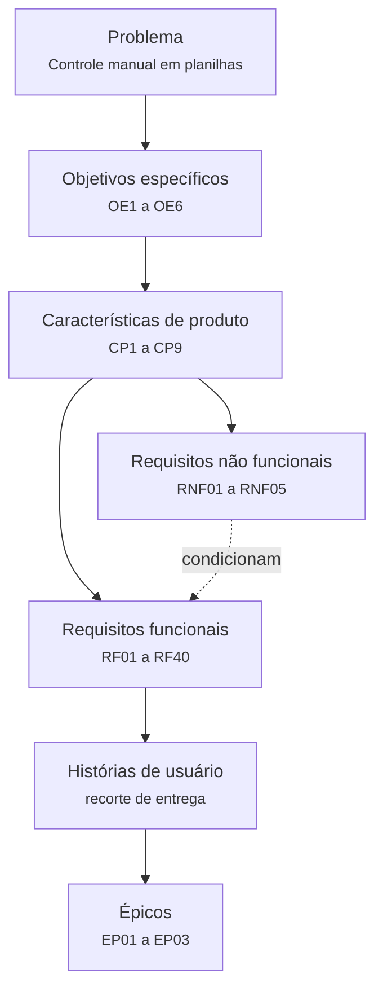

# Rastreabilidade dos requisitos {#rastreabilidade-dos-requisitos}

Esta página descreve **quais tipos de vínculo** o projeto mantém entre os elementos do escopo e
**onde cada vínculo é consultado**. Os vínculos não são mantidos aqui: eles pertencem aos registros
do [Catálogo de requisitos](requisitos-de-software.md), onde são atualizados junto com o requisito
que os origina.

## Cadeia de rastreabilidade {#cadeia-de-rastreabilidade}

A hierarquia liga o problema do cliente às declarações dos requisitos, e os RNFs condicionam os
requisitos funcionais em qualquer ponto dessa cadeia.

Cada elo é percorrível nos dois sentidos a partir do registro do requisito no catálogo.

## Tipos de vínculo mantidos {#tipos-de-vinculo-mantidos}

| Vínculo | O que relaciona | Onde é mantido | Como consultar |
| --- | --- | --- | --- |
| **Origem** | Requisito → característica de produto → objetivo específico | Campo *Origem e agrupamento* do registro | Abrir o registro e seguir os links de CP e OE para a [Solução e características](solucao-e-caracteristicas.md) |
| **Condição** | RNF → requisitos funcionais que ele condiciona | Campo *Condições e avaliação* do RF e campo *Aplica-se a* do RNF | Os dois lados do vínculo aparecem nos [registros dos RNFs](requisitos-de-software.md#registros-dos-requisitos-nao-funcionais) |
| **Dependência** | Requisito → requisitos de que ele depende | Campo *Condições e avaliação* do registro | Seguir os links em *Depende de*; os vínculos foram derivados da leitura das declarações e aguardam validação no refinamento |
| **Recorte de entrega** | Requisito → história de usuário → épico | Campos *Intenção e valor* e *Origem e agrupamento* do registro | Épicos e histórias estão agrupados em [MVP](mvp.md#epicos-do-incremento) |
| **Priorização** | Requisito → valor, esforço, Score e quadrante | Campo *Priorização* do registro | Método em [Priorização](priorizacao.md); valores vigentes no [índice do catálogo](requisitos-de-software.md#indice-dos-registros) |
| **Planejamento** | História → sprint de entrega | Campo *Entrega e situação* do registro | Distribuição completa em [Cronograma e entregas](cronograma-e-entregas.md) |
| **Evolução** | Requisito → decisões que o alteraram | Campo *Evolução* do registro | Visão por entrega em [Histórico de evolução](historico-de-evolucao.md) |

## Como percorrer uma relação {#como-percorrer-uma-relacao}

As três consultas mais frequentes, e o caminho de cada uma:

- **"De onde veio este requisito?"** Abra o registro no catálogo e leia *Origem e agrupamento*. O
  link da CP leva à descrição da característica e ao valor de negócio associado; o link do OE leva
  ao objetivo específico que a característica atende.
- **"O que quebra se eu mudar este requisito?"** Abra o registro e leia *Condições e avaliação*.
  *Depende de* lista o que ele consome; para descobrir quem depende dele, use a busca do site pelo
  ID — os registros que o citam aparecem no resultado. Verifique também a história associada e a
  sprint em que ela está planejada.
- **"Este RNF se aplica a quê?"** Abra o registro do RNF e leia *Aplica-se a*, que lista todos os
  requisitos funcionais condicionados por ele.

## Árvore de histórias de usuário {#arvore-de-historias-de-usuario}

Representação visual da cadeia entre objetivos específicos, características de produto, requisitos
funcionais e histórias de usuário do MVP.

<iframe width="768" height="432" title="Árvore de histórias de usuário: OE, CP, RF e US" src="https://miro.com/app/live-embed/uXjVEbdGrpI=/?embedMode=view_only_without_ui&moveToViewport=-803,-1669,5237,2757&embedId=541076974290" frameborder="0" scrolling="no" allow="fullscreen; clipboard-read; clipboard-write" allowfullscreen></iframe>

!!! note "A árvore é uma visão, não a fonte"
    O diagrama reproduz os vínculos registrados no catálogo em uma data específica. Quando um
    vínculo muda, a alteração é feita no registro do requisito e o diagrama é regerado a partir
    dele — nunca o contrário.

## Como a rastreabilidade é mantida {#como-a-rastreabilidade-e-mantida}

Para que os vínculos permaneçam coerentes, a equipe segue a mesma regra em toda alteração de
escopo:

1. **A alteração é feita no registro do requisito**, no catálogo — nunca em uma cópia.
2. **Os vínculos afetados são conferidos no próprio registro**: origem, RNFs, dependências,
   recorte de entrega e sprint.
3. **O motivo é anotado** no campo *Evolução* do registro e no
   [Histórico de evolução](historico-de-evolucao.md).
4. **As visões derivadas são atualizadas**: índice do catálogo, quadro do MVP, cronograma e
   diagramas que exibam o vínculo alterado.

A rotina completa, com os cuidados de cada momento do ciclo, está em
[Histórico de evolução](historico-de-evolucao.md#rotina-de-atualizacao).

## Versionamento

| Versão | Data | Descrição | Autor(es/as) |
| :----: | :--: | --- | --- |
| 1.0 | 12/10/2026 | Árvore de histórias de usuário relacionando OE, CP, RF e US, originalmente publicada na seção 10.6 do Backlog de produto | [Thiago Gomes](https://github.com/thgomxs) |
| 2.0 | 03/11/2026 | Página dedicada aos **tipos de vínculo e ao acesso à rastreabilidade**. Os vínculos por requisito passaram a ser mantidos nos registros do [Catálogo de requisitos](requisitos-de-software.md) | Equipe |
| 2.1 | 04/11/2026 | Remoção da numeração estrutural e ajuste da hierarquia dos títulos, com links estáveis e preservação das âncoras anteriores. | [Thiago Gomes](https://github.com/thgomxs) |
